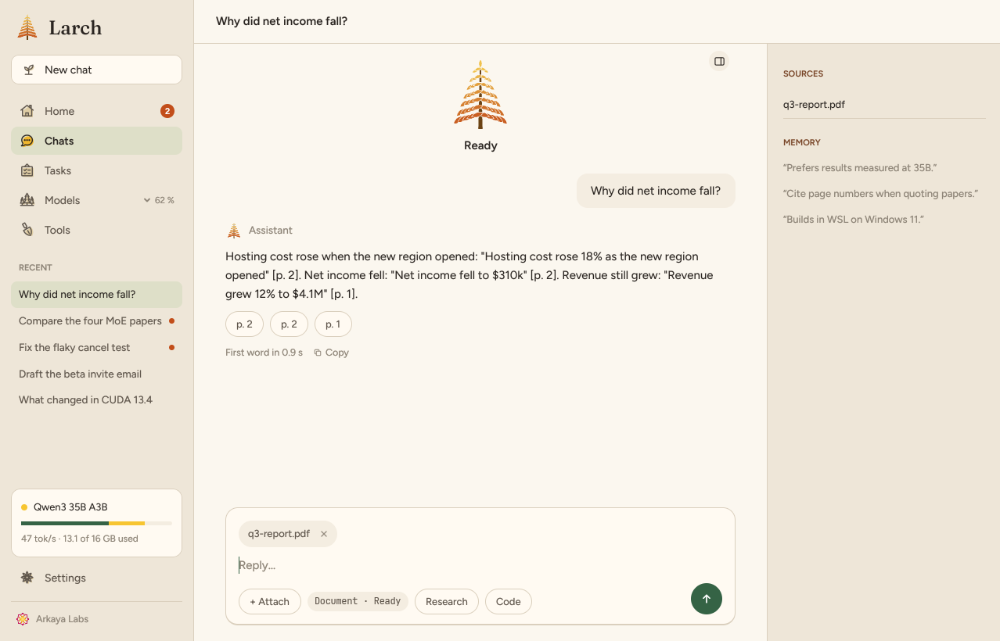

# Ask about your documents

Larch can read PDFs, papers, notes and web pages and answer questions about them, quoting the text it
relied on. This part of Larch is called Folio. This page covers how to use it and what to expect
with long files.

## In the app

1. Start a chat and press **+ Attach**, or drag files into the window.
2. Ask your question.

The answer quotes the document and puts the page after each quote, like
`"Hosting cost rose 18% as the new region opened" [p. 2]`. With several documents, each gets a
letter: `[B, p. 12]`.



## From the command line

```sh
larch-agent chat -m model.gguf --allow ~/Papers
```

Then name the file in your question, for example `Summarise the method in switch-routing.pdf`.

## Checked quotes

After the model answers, Larch looks for each quote on the page it cites. When a quote isn't there,
Larch adds a note under the answer saying so. It never edits the answer itself, so you see exactly
what the model wrote and which parts it couldn't back up.

A missing note doesn't prove the answer is right. It means the quoted words are on that page; the
model can still draw the wrong conclusion from them.

## Long documents

Larch picks one of three ways to read a set of documents, based on its size and your GPU memory:

| Size | What Larch does |
|---|---|
| Fits easily in the context | Reads it as part of the chat |
| Fits in the context with room for the conversation | Reads it once and keeps it in GPU memory, so each question only pays for its own words |
| Too long for the context | Splits it into sections, reads the sections in parallel and answers from the ones that matter |

You don't choose. If a first read would take too long on your hardware, Larch stops it, says so in
the chat, and reads the set by section instead.

## After a restart

With **Settings > Keep documents ready after restart** on (the default), Larch saves what it read
to disk. After you restart the app or the computer, it loads that instead of reading the documents
again, which is much faster for long files. Turn it off to keep nothing on disk but the files
themselves.

The cache lives in `doc-cache` in your data directory and uses at most 8 GiB, and never the last
2 GiB of free space on that drive. Set `docs_cache_bytes` in the
[agent's settings](configuration.md#agent-settings) to change the limit.

## Scanned PDFs

For pages that are pictures, Larch reads the text with the OCR built into your OS: Vision on macOS
and Windows OCR on Windows. On Linux it uses `tesseract` if it's installed. Some PDFs can't be read
by any of these, even though a viewer opens them; Larch says so instead of guessing.

## Limits

- Answers are only as good as the model. A small model on a long, technical document will miss
  things. Check important answers against the quoted page.
- Tables and figures are read as text. Charts aren't read.
- Your documents stay on your machine. Nothing is uploaded. See [Privacy and network](privacy.md).
